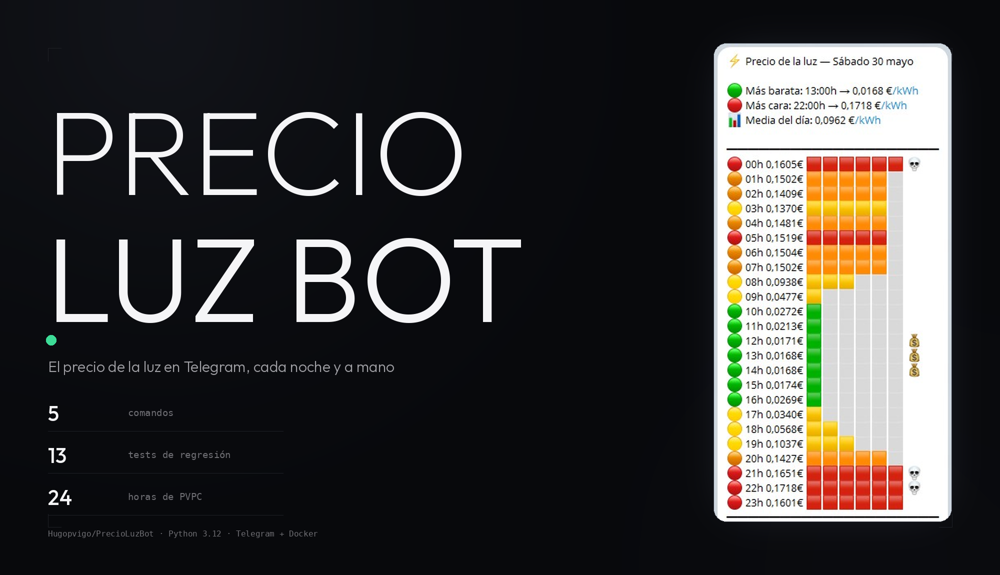
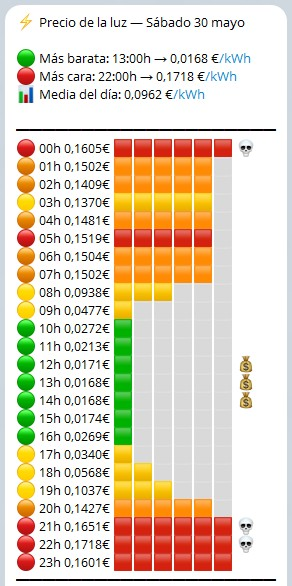

<meta property="og:title" content="PRECIOLUZBOT">
<meta property="og:description" content="Un bot de Telegram con los precios de la luz de España.">
<meta property="og:image" content="https://raw.githubusercontent.com/Hugopvigo/PrecioLuzBot/main/og.png">


<p align="center">
  
</p>

<p align="center">
  <b>Un bot de Telegram con los precios de la luz de España.</b><br>
  Cada noche avisa de la hora más barata; a mano también se consulta.
</p>

<p align="center">
  
  
  
  
  
</p>

---

## Qué es esto

Un bot de Telegram que publica los **precios horarios del PVPC** (indicador
1001 de Red Eléctrica, zona Península) y avisa cada noche de lo que viene:

- **Aviso diario** con el gráfico de las 24 horas, la hora más barata, la más
  cara y la media del día, con la comparación respecto al día anterior.
- **Consulta a mano** de hoy o de mañana, en formato tabla o gráfico.
- **Varios suscriptores** en el mismo bot: cada persona recibe su aviso.

Python 3.12, `python-telegram-bot`, APScheduler para la hora de aviso y
SQLite para recordar a quién hay que avisar. Docker incluido: se levanta con
un `docker compose up -d`.

## El aviso

<p align="center">
  
</p>

El mensaje lleva el resumen (más barata, más cara y media del día, con la
variación respecto a ayer) y debajo un gráfico de barras generado con
matplotlib: una barra por hora, coloreada por cuartil, con las **tres horas
más baratas** marcadas y las **tres más caras** también.

## Comandos

| Comando | Qué hace |
|---|---|
| `/start` | Suscribe al aviso diario |
| `/stop` | Da de baja el aviso diario |
| `/precio` | Consulta los precios de hoy o de mañana, con el gráfico |
| `/grafico` | Solo el gráfico, con las horas ordenadas por precio |
| `/ayuda` | Lista los comandos disponibles |

La lógica de `/precio` y `/grafico` es la misma: **de 00:00 a 19:59 muestra el
día de hoy; de 20:00 a 23:59, el de mañana** (si REE ya lo ha publicado).

Bajo el mensaje hay un teclado con botones: *Ver gráfico*, *Precio hoy*,
*Precio mañana* y *Ayuda*.

## Datos

Los precios salen de la [API ESIOS de Red Eléctrica](https://api.esios.ree.es),
indicador **1001 (PVPC 2.0TD)**, filtrado por `geo_id = 8741` (Península) y
convertidos de €/MWh a €/kWh. La clave (`ESIOS_API_TOKEN`) se pide en
`api_token@ree.es`.

Caching en dos niveles, para respetar la política de REE de **una sola
consulta al día**: primero en memoria (10 minutos) y luego en SQLite, donde
quedan el día, sus 24 horas y la media diaria.

Un detalle ya resuelto: cuando REE sirve un día entero a 0 (el día aún no está
publicado) el bot **no lo sirve ni lo guarda**. Lo detecta, lo descarta y
reintenta; hay una regresión cubierta por tests (`is_placeholder_day`).

## Despliegue

```bash
git clone https://github.com/Hugopvigo/PrecioLuzBot.git
cd PrecioLuzBot

cp .env.example .env      # y rellena TELEGRAM_BOT_TOKEN y ESIOS_API_TOKEN
docker compose up -d
```

El bot escribe en `./data` (volumen montado en `/data`): ahí queda la base de
datos con los suscriptores y los precios cacheados.

```bash
docker compose logs -f precioluz     # ver el log
docker compose restart                # reiniciar
docker compose down                   # parar
```

`install.txt` es la guía larga para instalarlo en un VPS: requisitos,
actualización, copia de seguridad de la base de datos y resolución de
problemas.

### Variables de entorno

| Variable | Para qué | Por defecto |
|---|---|---|
| `TELEGRAM_BOT_TOKEN` | Token del bot de [@BotFather](https://t.me/BotFather) | *obligatoria* |
| `ESIOS_API_TOKEN` | Clave de la API ESIOS de REE | *obligatoria* |
| `TZ` | Zona horaria | `Europe/Madrid` |
| `NOTIFY_HOUR` | Hora del aviso diario | `20` |
| `NOTIFY_MINUTE` | Minuto del aviso diario | `15` (en `.env.example`) |
| `LOG_LEVEL` | Nivel de logging | `INFO` |
| `DB_PATH` | Ruta de la base de datos SQLite | `/data/subscribers.db` |

Si a la hora del aviso REE todavía no ha publicado los precios, el bot
**reintenta a los 60 y a los 30 minutos** y, si siguen sin estar, avisa a los
suscriptores de que los precios llegan tarde.

## Tests

13 tests de regresión, sin red: el placeholder de día sin publicar, el
conversor a MarkdownV2 y el reenvío del gráfico a varios suscriptores (el
mismo buffer para todos, que era el bug de las fotos vacías).

```bash
# El Dockerfile solo copia el paquete bot/, así que los tests se pasan a mano
docker cp tests precioluz:/tmp/pltests
docker exec precioluz python -m unittest discover -s /tmp/pltests -t /app -v
```

## Repositorio

```
precioluzbot/
├── bot/
│   ├── main.py       arranque, polling, apagado ordenado
│   ├── handlers.py   comandos y teclado en línea
│   ├── scheduler.py  aviso diario y reintentos
│   ├── esios.py      cliente de la API de REE y caché
│   ├── db.py         SQLite: suscriptores, precios y medias
│   ├── cache.py      caché en memoria
│   ├── chart.py      gráfico de barras con matplotlib
│   ├── formatter.py  mensajes en Markdown enriquecido
│   └── rich.py       cliente de la API de Telegram
├── tests/            tests de regresión
├── src/              captura del bot
├── cabecera.png       cabecera del README
├── bot.jpg            captura del bot
├── install.txt       guía de instalación en VPS
├── Dockerfile
└── docker-compose.yml
```

## Licencia

El código de este repositorio está bajo **CC BY-NC-SA 4.0** (atribución, no
comercial y obras derivadas bajo la misma licencia). Véase
[LICENSE](LICENSE).
